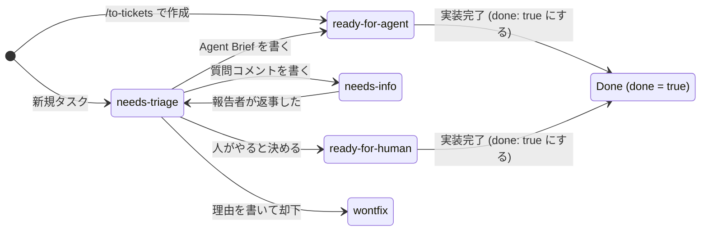

# Vikunja スキル

このファイルは人間向けです。`SKILL.md` などからはリンクしていないので、エージェントは読みません。

[English (README.md)](README.md)

## このスキルについて

`/vikunja` は、ローカルの Vikunja を `user-vikunja` MCP 経由で操作する際のルール（画面上のチケット番号ではなく数値の `Task id` を渡すこと、`format: markdown` と最小 `fields` の指定、カテゴリラベルの後付け、カンバン列による状態遷移など）をエージェントに教えるスキルです。

エージェントが読むファイル：

- `SKILL.md`: 日常のタスク操作、主要ツールの引数と最小 `fields`、カテゴリラベル付与ルール、カンバン列の状態遷移。
- `setup.md`: 初回のみのプロジェクト作成、カンバン6列の構築、`AGENTS.md` への各種 ID 記録。
- `worktree.md`: ワークスペースの外に worktree を切る。エージェントの作業ディレクトリはそこ。`--ff-only` のあと `worktree remove`、続けて `branch -d`。
- `glossary.md`: `Ticket number`・`Task id`・`Label`・`Bucket`・`Done` の取り違え防止用の用語集。

## カンバン列の遷移とラベル

### 役割分担

- **状態（6列の Bucket）**: トリアージの状態5つ（`needs-triage`, `needs-info`, `ready-for-agent`, `ready-for-human`, `wontfix`）と完了列 `Done` はすべてカンバンの列（Bucket）だけで表現します。状態用のラベルは作りません。
- **種類（2種の Label）**: `bug` と `enhancement` の2つだけをラベルとしてタスクに1つ付与します。

| 列 (Bucket) | いつここに入るか | 次にどこへ行くか |
| --- | --- | --- |
| `needs-triage` | 新しく作られたタスクの初期列（`default_bucket_id`）。`needs-info` で返事が来たときもここへ戻る | `needs-info` / `ready-for-agent` / `ready-for-human` / `wontfix` |
| `needs-info` | 報告者に追加の情報を聞いているあいだ | 返事が来たら `needs-triage` |
| `ready-for-agent` | Agent Brief が書かれ、エージェントがそのまま着手できる。`/to-tickets` で切ったチケットは最初からここ | 実装が終わったら `Done` |
| `ready-for-human` | 判断や手作業が要り、人が実装する | 実装が終わったら `Done` |
| `wontfix` | やらない、または既に実装済みで却下した。**`done` にはしない** | ここで終わり |
| `Done` | 実装が終わってタスクを `done: true` にしたとき（`done_bucket_id` により自動移動） | 差し戻すときだけ元の列へ |

### 遷移図

### 運用のポイント

- **状態は列（Bucket）のみ、種類はラベルのみです。** 画面でカードをドラッグして列を動かせば、そのまま状態が切り替わります（ラベルの付け替えは不要です）。エージェントからは `expand: ["buckets"]` で現在の列を参照します。
- **完了と却下は別です。** 実装が終わったものだけ `tasks_update` で `done: true` にします。`Done` は Vikunja の完了列（`done_bucket_id`）なので、`done: true` にすると自動で `Done` 列へ移ります。
- **`wontfix` は `done` にしません。** Vikunja の完了列は1つしか無いため、`wontfix` のタスクを `done` にすると `Done` 列へ吸い込まれて完了と混ざります。`wontfix` 列へ移し、未完了のまま置きます。
