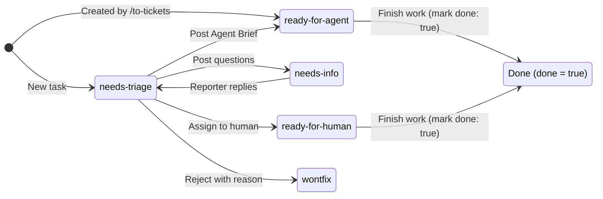

# Vikunja Skill

This file is for humans. No skill file links to it, so agents do not read it.

[日本語版 (README.ja.md)](README.ja.md)

## About this skill

`/vikunja` teaches Cursor agents how to operate the local Vikunja issue tracker via the `user-vikunja` MCP without hitting common pitfalls (such as passing UI ticket identifiers instead of numeric task IDs, forgetting `format: markdown`, or fetching bloated responses without `fields`).

Files read by the agent:

- `SKILL.md`: Daily task operations, tool argument names and minimal `fields`, category label rules, and kanban bucket state transitions.
- `setup.md`: One-time project creation, setting up the 6-column kanban board, and recording IDs in `AGENTS.md`.
- `worktree.md`: Worktree outside the workspace repo. Agent cwd moves there. After `--ff-only`, `worktree remove` then `branch -d`.
- `glossary.md`: Disambiguation for `Ticket number`, `Task id`, `Label`, `Bucket`, and `Done`.

## Kanban Column Workflow & Labels

### Separation of concerns

- **State (6 Kanban Buckets)**: The five triage states (`needs-triage`, `needs-info`, `ready-for-agent`, `ready-for-human`, `wontfix`) and `Done` are represented solely by kanban buckets (columns). Do not create labels for states.
- **Category (2 Labels)**: Only `bug` and `enhancement` are labels. Each task gets one category label.

| Column (Bucket) | When a task lands here | Where it goes next |
| --- | --- | --- |
| `needs-triage` | Default column for new tasks (`default_bucket_id`); also returns here after the reporter replies to `needs-info` | `needs-info`, `ready-for-agent`, `ready-for-human`, or `wontfix` |
| `needs-info` | Waiting on the reporter to answer questions | Back to `needs-triage` once they reply |
| `ready-for-agent` | Has an Agent Brief and is ready for an AFK agent; `/to-tickets` slices start here | `Done` when finished |
| `ready-for-human` | Needs human judgment, access, or implementation | `Done` when finished |
| `wontfix` | Rejected or already implemented. **Do not mark `done`** | Stays here |
| `Done` | Work is finished and the task is marked `done: true` (moves automatically via `done_bucket_id`) | Move out only to reopen |

### State diagram

### Operating rules

- **State is the bucket; category is the label.** Dragging a card between columns in the UI immediately updates its state without going out of sync with labels. Agents read the current bucket via `expand: ["buckets"]`.
- **Finished and rejected stay separate.** Only finished work is marked `done: true` via `tasks_update`. Because `Done` is the view's `done_bucket_id`, marking a task `done: true` moves the card into `Done` automatically.
- **Never mark `wontfix` as `done`.** Vikunja has a single done bucket. Marking a rejected task `done` would pull it out of `wontfix` into `Done`. Move the card to the `wontfix` column and leave `done` false.
